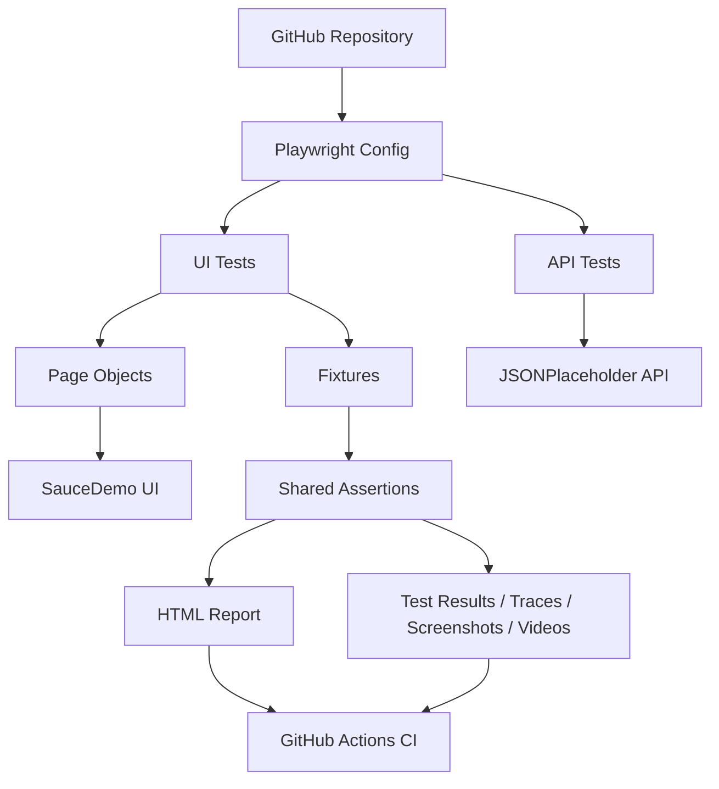

# E-Commerce Quality Engineering Framework

A professional TypeScript and Playwright test automation portfolio project for validating an e-commerce demo application. This repository demonstrates how a quality engineering team structures UI, API, and reporting automation for a realistic e-commerce workflow while keeping the framework maintainable, interview-friendly, and GitHub-ready.

## Project overview

This project is designed to showcase SDET and Automation Test Engineer skills using a real public test application: SauceDemo. The framework covers critical user journeys such as login, product discovery, sorting, cart functionality, and checkout validation using Playwright. It also includes API automation through JSONPlaceholder to demonstrate backend validation skills with the same tooling stack.

The project intentionally follows a clean automation architecture with reusable page objects, fixtures, utilities, clear naming conventions, and artifact-based reporting. It is well suited for GitHub portfolios and interview discussions about automation design, maintainability, and practical QA strategy.

## Business requirements

The goal is to validate that an e-commerce storefront meets critical quality expectations:

- Users can sign in successfully with valid credentials
- Invalid login attempts are blocked with clear error messaging
- Product listings load correctly and can be sorted
- Users can add and remove items from the cart
- Cart count and contents remain consistent with user actions
- Checkout validation prevents incomplete orders
- Successful checkout can be completed with valid data
- Public API endpoints support reliable CRUD and negative-path validation
- CI pipeline publishes evidence when failures occur

## Technology stack

- TypeScript
- Playwright
- Playwright API testing
- Page Object Model (POM)
- HTML report generation
- Git and GitHub
- GitHub Actions
- Node.js and npm

## Framework architecture

The framework separates responsibilities into UI flows, API testing, shared page objects, reusable fixtures, and reporting artifacts. This keeps each layer focused and reduces duplication across test cases.



## Repository structure

```text
.
├── .github/
│   └── workflows/
│       └── playwright.yml
├── tests/
│   ├── api/
│   │   ├── JsonPlaceholderClient.ts
│   │   └── posts-api.spec.ts
│   ├── pages/
│   │   ├── LoginPage.ts
│   │   ├── ProductsPage.ts
│   │   ├── CartPage.ts
│   │   └── CheckoutPage.ts
│   ├── fixtures.ts
│   ├── first.spec.ts
│   ├── login.spec.ts
│   ├── products.spec.ts
│   ├── cart.spec.ts
│   ├── checkout.spec.ts
│   ├── debugging.spec.ts
│   └── ...
├── .env.example
├── .gitignore
├── package.json
├── playwright.config.ts
├── tsconfig.json
├── README.md
├── TEST-PLAN.md
├── TEST-CASES.md
├── TEST-STRATEGY.md
├── playwright-report/
├── test-results/
├── package-lock.json
└── node_modules/
```

## Prerequisites

- Node.js 20 or newer
- npm 10+
- Git
- Network access to install Playwright browsers and access public demo systems

## Installation

```bash
npm install
npx playwright install --with-deps chromium
```

## Running the suite

Run the full project suite:

```bash
npm test
```

Run the smoke test:

```bash
npx playwright test tests/first.spec.ts
```

Run login and product tests:

```bash
npx playwright test tests/login.spec.ts tests/products.spec.ts
```

Run cart and checkout tests:

```bash
npx playwright test tests/cart.spec.ts tests/checkout.spec.ts
```

Run API tests:

```bash
npx playwright test tests/api/posts-api.spec.ts
```

Run debugging/reporting smoke test:

```bash
npx playwright test tests/debugging.spec.ts
```

Run with headed browser:

```bash
npm run test:headed
```

Open the HTML report:

```bash
npm run report
```

## Test scenarios covered

- Successful login
- Invalid credentials flow
- Product listing validation
- Sorting by name and price
- Add and remove item from cart
- Empty-cart validation
- Checkout required-field validation
- Successful order completion
- API GET, POST, PUT, PATCH, DELETE checks
- Negative API scenario for missing records

## Reporting and debugging

The Playwright configuration stores:

- HTML reports
- Screenshots on failure
- Videos on failure
- Trace files on failure
- Console logs for runtime debugging

This makes it easier to diagnose root causes during CI or local execution without relying on ad hoc manual checks.

## CI/CD workflow details

The GitHub Actions workflow in `.github/workflows/playwright.yml` does the following:

- Checks out the repository
- Sets up Node.js
- Installs dependencies with `npm ci`
- Installs Playwright browsers
- Runs the automated suite
- Uploads the HTML report as an artifact
- Uploads failure artifacts from `test-results/`
- Runs on pushes and pull requests to `main`

## Known limitations

- The UI tests target a public demo site, not a production e-commerce application
- SauceDemo is intentionally static and limited in scope compared with a real enterprise app
- API tests use JSONPlaceholder, which simulates a public CRUD API rather than a production API contract
- Database validation is not yet implemented, although it is planned for future enhancement

## Future enhancements

- SQL and database validation using a dedicated test database
- Environment-based configuration and secret management for multiple test environments
- Data-driven testing using JSON/CSV fixtures
- Additional negative-edge and boundary tests
- API schema validation with dedicated JSON schema checks
- Better reporting with custom dashboards and trend analysis
- Lightweight custom utilities for retries, logging, and reusable assertions

## Documentation references

- [TEST-PLAN.md](TEST-PLAN.md)
- [TEST-CASES.md](TEST-CASES.md)
- [TEST-STRATEGY.md](TEST-STRATEGY.md)

## Summary

This project demonstrates a realistic, maintainable, and professional test automation framework that can be used to discuss SDET responsibilities, testing strategy, and CI quality engineering in interviews and on GitHub.
