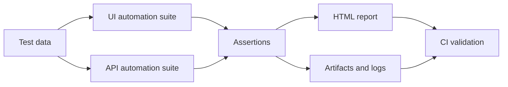

# Test Strategy

## 1. Strategy overview

The testing strategy for this portfolio project focuses on layered quality validation using real user journeys, realistic API contracts, and evidence-based failure reporting. The primary goal is to reduce regression risk while keeping the test suite maintainable.

## 2. Test levels

### Unit-level logic

This project does not currently implement traditional unit tests, but the same quality principles apply to the shared utility and page abstractions that may be introduced later.

### API validation

Playwright API testing is used for contract and workflow verification against a public mock service. This provides early feedback on backend assumptions without requiring a full application backend.

### UI validation

UI tests validate user-visible business workflows in a browser, with a focus on business-critical flows that users depend on in an e-commerce experience.

## 3. Test design principles

- Prefer stable UI selectors and explicit assertions
- Validate user-visible behavior, not implementation details
- Keep tests independent and deterministic where practical
- Separate the UI and API layers to preserve clarity
- Use fixtures and page objects to reduce duplication
- Retain failure artifacts for quick diagnosis

## 4. Test data

The project uses public demo credentials and public test data sources. Sensitive credentials are avoided and environment variables are used for configuration.

## 5. Reporting and debugging strategy

When a failure occurs, the framework captures:

- HTML report
- screenshots
- traces
- videos
- console logs

This supports rapid debugging and provides portfolio-ready evidence for quality engineering work.

## 6. Execution strategy

The project is designed to run locally and in GitHub Actions. Execution is intentionally simple to understand and to demonstrate a professional CI/CD flow for automation portfolios.

## 7. Continuous improvement

Future improvements include broader negative-edge coverage, database testing, custom utilities, and environment-specific configuration for production-like test execution.

